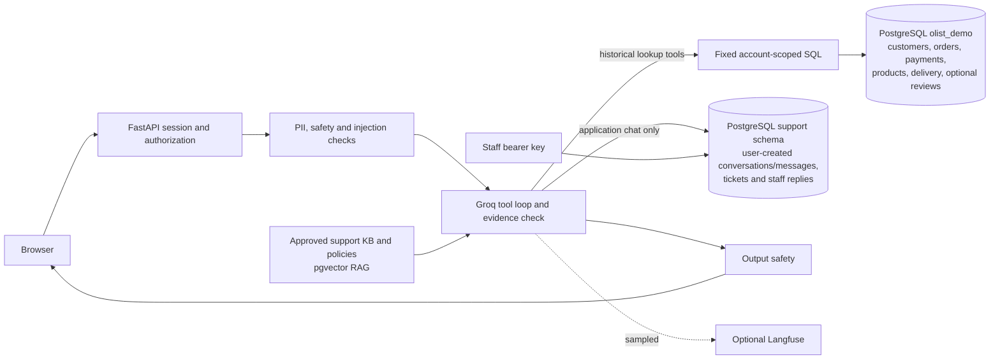

# AI customer support agent with historical Olist demo

A FastAPI support assistant with durable PostgreSQL conversations, a staff inbox, tool calls, evidence-checked RAG, PII redaction, prompt-injection defenses, safety checks, evaluations and optional Langfuse tracing. Its Demo Office Store and Olist demo profiles are isolated. The Office Store profile contains approved support policies; the Olist profile contains dataset-scope documentation only, while Olist transactions and feedback stay in relational tables.

The Olist Brazilian E-Commerce Public Dataset is historical marketplace data released on Kaggle for roughly 2016–2018. It contains transactional records and post-purchase reviews, **not customer-support chat transcripts or customer-agent conversations**. This project is an independent, non-live demonstration and is not affiliated with Olist. The Kaggle page lists **CC BY-NC-SA 4.0**; attribution, non-commercial use and share-alike terms apply. Review the [dataset source and current terms](https://www.kaggle.com/datasets/olistbr/brazilian-ecommerce) before reuse. Do not present the demo as live order support.

## What works in the repository

- FastAPI chat with secure browser sessions, saved conversation history and idempotent retry.
- Separate authenticated staff inbox for support handoffs and replies.
- Groq GPT-OSS generation and Groq GPT-OSS Safeguard checks, configured for quota-based use. Limits are account-specific; the app does not promise unlimited free usage.
- PII redaction using Presidio pattern recognizers without loading a large spaCy NER model; injection quarantine; fail-closed safety behavior.
- pgvector RAG with relevance and evidence checks. Missing evidence produces an honest unavailable answer.
- Olist relational import and fixed SQL tools are prepared locally for historical customer, order, payment, product and delivery data. The nine source CSVs are downloaded and locally validated; they remain ignored under `data/raw/olist/` and have **not** been imported into Neon. Olist review scores/dates can be stored separately as historical feedback; review comments are excluded by default.
- Approved support knowledge and policies are stored as a separate pgvector RAG source. Olist transactions and reviews are never ingested into that policy knowledge base.
- PostgreSQL `support_conversations` and `support_messages` store conversations created by users in this application. These are application chat history, not Olist historical records. No historical customer-agent conversations are fabricated.
- Langfuse direct tracing is optional. Sampling and an application-side monthly trace cap are configurable. Check actual units in its dashboard.
- Separate evaluation scenarios exist for the Olist demo. They are not a scored benchmark.

## Architecture



There are three distinct data sources: approved support knowledge and policies for pgvector RAG; Olist's historical transactional tables for fixed read-only SQL tools; and conversations/messages generated by users interacting with this application. Olist tables use the separate `olist_demo` schema. The dataset contains no support chats. Reviews are optional historical feedback, stored separately from the policy knowledge base; comment text is excluded by default and never treated as a transcript or policy. The Olist model cannot execute SQL or perform refunds, cancellations, shipping changes or seller contact. Account choice is bound to an owned, empty application conversation. Order IDs and dataset customer IDs are never authentication credentials; public UI references are opaque aliases. Queries still check that every alias belongs to the selected demo account.

The two KB profiles filter by profile and embedding provider/model. Equal vector dimensions do not imply compatible vectors. The existing local database uses Gemini embeddings; the prepared Render configuration uses local FastEmbed BGE Small. Re-embed both profiles with the selected model before deployment.

See [architecture](docs/ARCHITECTURE.md), [security](docs/SECURITY.md), [dataset and storage](docs/DATABASE_STORAGE_REPORT.md), [evaluations](docs/EVALUATION.md), and [free-tier deployment](docs/FREE_TIER_DEPLOYMENT.md).

## Local setup

Use Python 3.12. Copy `.env.example` to `.env`, generate distinct random 32+ character `ADMIN_API_KEY` and `SERVICE_API_KEY`, and fill in `DATABASE_URL` and `GROQ_API_KEY` locally. Never paste credentials into chat or commit `.env`.

```powershell
uv pip install --python .venv/Scripts/python.exe -e ".[dev,pii,free]"
.venv/Scripts/python.exe -m support_agent.db
.venv/Scripts/python.exe -m support_agent.kb.ingest --docs knowledge_base/approved --profile office_store
.venv/Scripts/python.exe -m uvicorn support_agent.server:app --host 127.0.0.1 --port 8001
```

Open `http://127.0.0.1:8001/`. Staff inbox: `/admin/inbox`. Use a PostgreSQL database with pgvector enabled. The app does not import data or run migrations at startup in production. `GET /healthz` is inexpensive liveness; `/readyz` checks database readiness.

To change embedding provider/model, first plan a controlled re-ingestion of each KB profile. Never run `kb.ingest --reset` against shared knowledge data; `--reset` only deactivates the selected profile now.

## Olist dataset and account setup

The dataset files are not included in Git. After dataset download has been authorized, install the Kaggle CLI and run from the repository root:

```powershell
kaggle datasets download -d olistbr/brazilian-ecommerce -p data/raw/olist --unzip
.venv/Scripts/python.exe -m support_agent.olist.importer --validate-only
```

Validation requires all nine expected CSVs, checks columns, nulls, primary-key duplicates, date/numeric formats and foreign-key orphans, then reports file sizes and row counts. The default relational import excludes geolocation and review comment text; structured review scores/dates are kept only in `olist_demo.reviews`. No Olist transaction, review, or customer-agent conversation is embedded into the approved support-policy knowledge base. Raw CSV data remains under the ignored `data/raw/olist/` path.

Prepare the database only after confirming Neon plan, remaining quota and current storage:

```powershell
.venv/Scripts/python.exe -m support_agent.olist.importer --storage-report
.venv/Scripts/python.exe -m support_agent.db
.venv/Scripts/python.exe -m support_agent.olist.migrate
.venv/Scripts/python.exe -m support_agent.olist.importer
.venv/Scripts/python.exe -m support_agent.kb.ingest --docs knowledge_base/olist_demo --profile olist_demo
```

Import is one transaction and stops with rollback if actual database size crosses 700 MB. It never deletes existing support data. The nine CSVs were locally validated; the approved read-only Neon preflight measured 9,650,176 bytes (9.20 MiB) before import. Olist growth remains an estimate of 120–165 MB, with a 170 MB planning allowance; imported table sizes and post-import storage are not measured because no import has run. See [storage preflight](docs/DATABASE_STORAGE_PREFLIGHT.md) and [database storage report](docs/DATABASE_STORAGE_REPORT.md).

The chat page offers “Try historical Olist data.” Selecting a curated demo account starts a new conversation and displays that account’s opaque historical order references. Responses disclose the historical-data limitation.

## Tests and evaluations

Run deterministic tests and lint without cloud inference:

```powershell
$env:SAFETY_MODEL_URL=''; $env:TRACING_ENABLED='0'; .venv/Scripts/python.exe -m pytest tests -p no:cacheprovider
.venv/Scripts/python.exe -m ruff check src tests eval
```

PostgreSQL integration tests are opt-in and require an explicitly designated test database. They must never point to the user's production database. The Olist scenarios in `eval/datasets/olist_demo_scenarios.jsonl` cover authorization, missing records, payments, products, historical status, unsupported actions, prompt injection, PII, service failures, ambiguity and evidence gaps. No Olist model evaluation score or tau2-bench result is claimed.

## Render native Python preparation

`render.yaml` describes a native Python Free web service with one worker and no persistent disk. Build command:

```text
pip install --require-hashes -r requirements.lock && pip install -e ".[free]"
```

Start command:

```text
uvicorn support_agent.server:app --host 0.0.0.0 --port $PORT --workers 1 --limit-concurrency 4 --timeout-keep-alive 5 --no-access-log
```

Health path: `/healthz`. Supply Neon, Groq, admin and service secrets through Render's unsynchronized environment variables. Gemini fallback defaults off. Verify every provider's actual account plan and quotas before use. Free Render services sleep after idle and have cold starts; they are for a portfolio demo, not production-critical support. Account-level limits and actual Render memory use remain unverified. See [deployment details](docs/FREE_TIER_DEPLOYMENT.md).

## License and intended use

Application code is MIT licensed. Olist data has separate CC BY-NC-SA 4.0 terms. The demonstration uses public historical, pseudonymous records and curated public demo identities; it is not live customer data or live support. It is not suitable for production-critical customer support. Do not claim current Olist affiliation, commercial dataset rights, live order status, or operations the app cannot perform.
