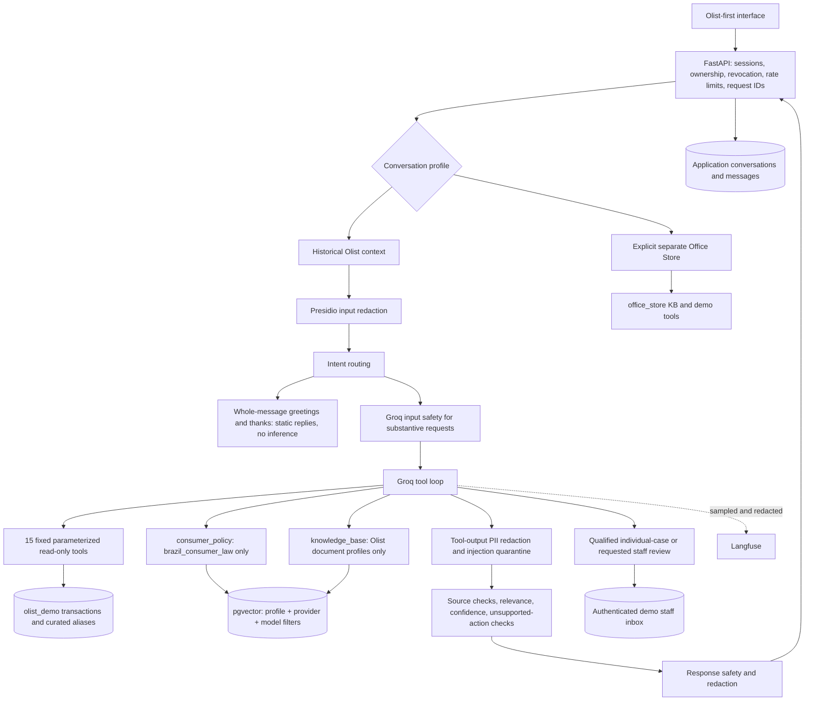

# Olist historical support architecture

Updated 2026-11-09. Target: Render Native Python, Neon PostgreSQL/pgvector,
Groq generation/safety, FastEmbed and optional redacted Langfuse tracing.

## Data boundaries

| Source | Storage/profile | Use |
|---|---|---|
| Historical transactions, products, sellers, reviews | Relational `olist_demo` tables | Fixed authorized SQL only |
| Dataset scope | `olist_transaction_profile` | Curated documentation RAG, never transaction rows |
| General Brazilian law | `brazil_consumer_law` | Official sources with BR jurisdiction and provenance |
| Independent app procedures | `olist_demo_policy` | Labeled demonstration assumptions, never merchant terms |
| Fictional Office Store policies | `office_store` | Explicit separate demo only |
| Actual application chats/tickets | Public support tables | Durable user/staff history, never invented historical transcripts |

The server validates conversation ownership before loading profile/account into
request context. Every transaction query resolves aliases within the selected
account's unique-customer scope. Model arguments cannot supply account identity
or SQL. Possessing another account's order/product/seller alias grants no access.
Statistics describe account-observed purchases, not the marketplace. Item and
payment queries are separate to avoid multiplying monetary totals.

Only registered schemas are exposed, and dispatch validates arguments again.
Olist dispatch rejects Office Store tools and direct ticket mutations. Raw IDs,
ZIPs, cities and comments are not projected into outputs; final Olist answers
containing raw 32-hex identifiers are withheld. Seller state is a broad region.
Missing records/dates remain unknown. There is no live tracking or action tool.

## Retrieval and legal grounding

The conversation profile remains `olist_demo` for compatibility; the four
retrieval profiles above are separate. Legacy `olist_demo` embeddings are not
silently reused. Olist general retrieval searches the three Olist document
profiles; `consumer_policy` searches law only. Office Store is excluded.
Both database and memory retrieval preserve provider/model isolation.
Render uses English FastEmbed `BAAI/bge-small-en-v1.5`, 384 dimensions. Curated
English legal summaries cite the controlling Portuguese official sources.
Existing incompatible vector dimensions require a separately approved migration.

Legal documents retain authority, original/retrieved URLs, article, retrieval
date, jurisdiction, verified status and content version. Ingestion/retrieval
validate legal provenance. General law cannot establish Olist-specific terms or
adjudicate an individual historical claim. Unsettled cases require qualified
review; demo staff are not official Olist support. Unsupported merchant-policy
claims and unperformed actions are withheld or routed for review.

## Security and lifecycle

PII redaction precedes classification, logs and persistence. The local social
matcher accepts only whole simple messages; mixed requests retain semantic
routing and substantive safety gates. Tool outputs are redacted and quarantined.
Confidence, evidence relevance and response safety remain in place, along with
staff authentication, revocation, rate limits, leases, request IDs and tracing
redaction. No hosted evaluation has run during this upgrade.

Startup performs readiness checks only, never migrations or imports. Version-3
Olist readiness requires all prepared tables, seller aliases, a successful import
marker and curated accounts. Missing/old initialization is explicit; no profile
fallback is substituted. Production also requires all three Olist document
profiles for its configured embedding model.

Review comments are stored separately from review facts and are unavailable to
tools until Portuguese PII redaction is validated. Geolocation preserves all raw
rows and builds an internal ZIP-prefix aggregate; customer tools do not expose
coordinates. Neither data source enters RAG. See the data dictionary, policy
source register and storage preflight.
