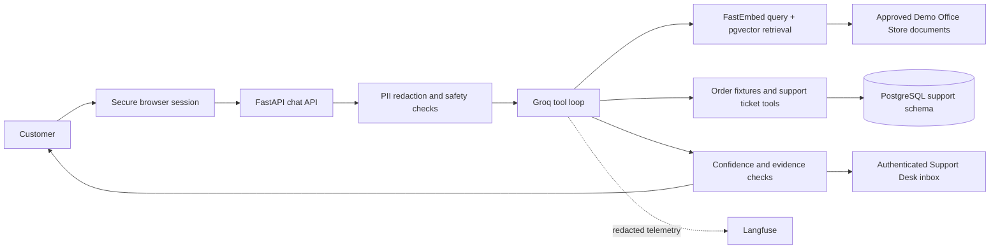

# Application architecture

This repository is the Demo Office Store customer-support application. It answers questions from the five approved Markdown documents in `knowledge_base/approved/`, keeps browser conversations in PostgreSQL, and offers authenticated staff review.

Retrieval returns source excerpts with citations. The assistant may cite only retrieved chunks, and the evidence/relevance checks abstain when the sources do not support an answer. The five documents cover shipping, returns (including refund guidance), billing, warranty, and account access. Their content is fictional demonstration policy, not policy for a real merchant.

The database contains application sessions, conversations, messages, turns, sample support orders, tickets, staff replies, audit and rate-limit records, evaluation runs, and pgvector chunks. See `src/support_agent/db.py` and `src/support_agent/kb/store.py` for the schema and store behavior. The Render blueprint uses the native Python runtime and the same FastEmbed model configured for local retrieval.
