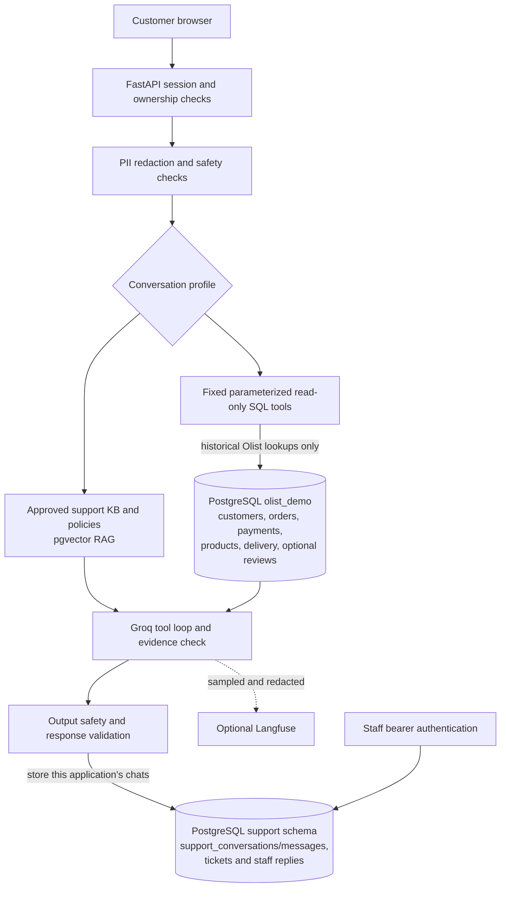

# Architecture

## Three separate data sources

The system keeps three kinds of data separate:

1. **Approved support knowledge and policies** are retrieved with pgvector RAG.
   Demo Office Store policies stay in that support knowledge base. The Olist
   dataset overview is only dataset documentation and limitations; it is not a
   support policy. Olist transaction rows and reviews are never ingested as
   support knowledge.
2. **Olist historical records** are stored in relational `olist_demo` tables
   and read through fixed, account-scoped SQL tools. The dataset provides
   marketplace transactions and post-purchase reviews, not support chat
   transcripts. Review scores and dates may be retained as historical feedback;
   free-text review comments are excluded by default and remain separate from
   the policy knowledge base.
3. **Application conversations** are created when users chat with this service.
   They are stored in the existing `support_conversations` and
   `support_messages` tables, with staff tickets/replies in the support schema.
   These are real interactions with this application, not historical Olist
   conversations. The system does not fabricate customer-agent transcripts.

Each application conversation is created in one support profile; switching
profiles requires a new empty conversation. Knowledge retrieval filters by
profile, embedding provider, and model. Chunk uniqueness includes all of those
dimensions, so a new embedding model can be ingested beside existing vectors
without silently replacing them.

Olist account identity is selected in the authenticated browser session and
stored against its owned conversation. Model-supplied account identifiers are
never accepted. Each fixed query also restricts the returned order or product
to that selected account. Public references are generated opaque aliases.
Staff access remains separate through the existing staff API key.

## Request path and boundaries

The existing application runs PII redaction, semantic routing, input safety,
prompt-injection quarantine, fixed-schema tool dispatch, evidence checks,
confidence scoring, output safety and durable response storage. Failure to run a
required safety check blocks the operation. Provider 429 responses remain a
controlled temporary-unavailability response; Gemini generation fallback is
disabled unless separately verified and deliberately configured.

Olist records are queried relationally. They are never embedded as individual
transactions, reviews, or conversations. Olist supplies no customer-support
chat transcripts; only messages generated by users of this application are
stored in the support conversation tables. Review score/date records, when
imported, remain in the separate relational reviews table. Review comments,
geolocation and postal-code/location fields are excluded from the initial
import. Dataset documentation describes scope and limitations; it does not
create or imply company support policy.

## Schema and operating limits

Support tables remain in the existing schema. Olist tables live in
`olist_demo`. Both migrations are explicit and additive; service startup never
imports data. Render uses one process, a small database pool, a single inference
slot, remote Groq inference and local FastEmbed. `/healthz` is a cheap liveness
route; `/readyz` checks PostgreSQL readiness. Local model memory and Render
memory have not been proven equivalent; see the deployment report.
